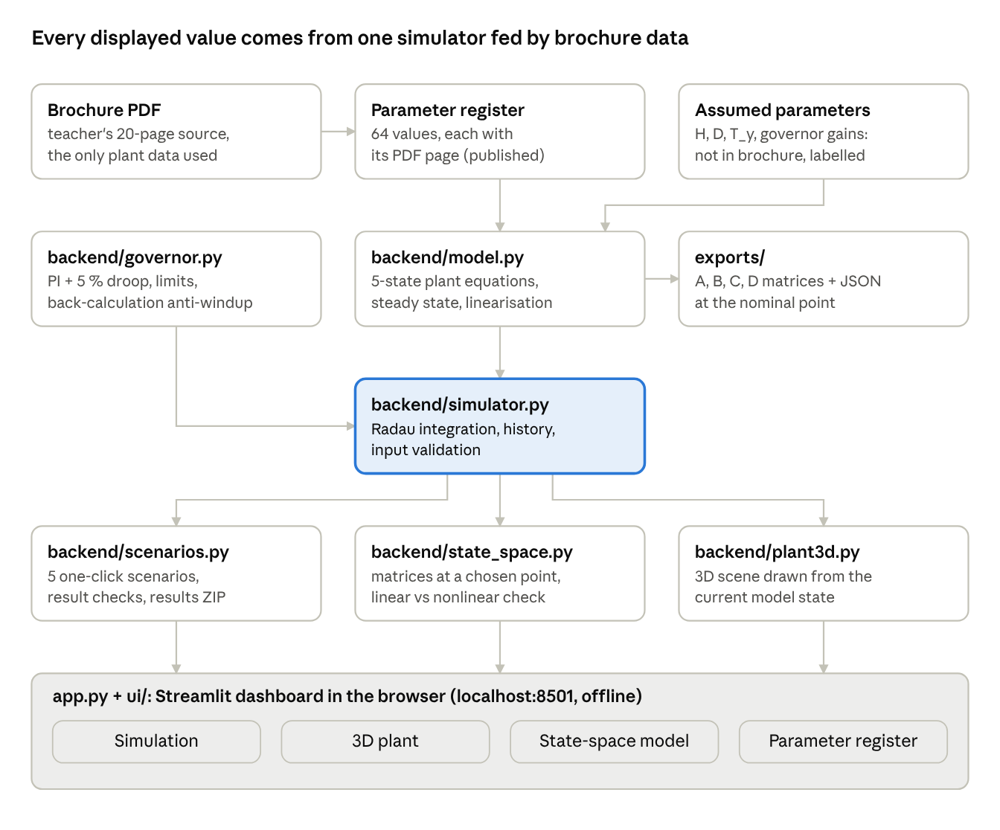
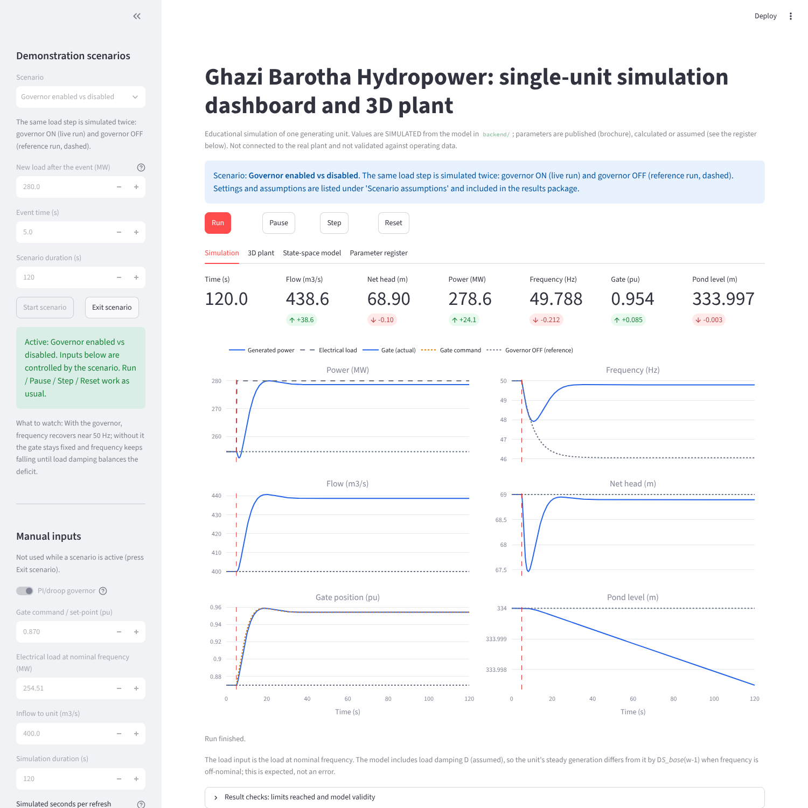
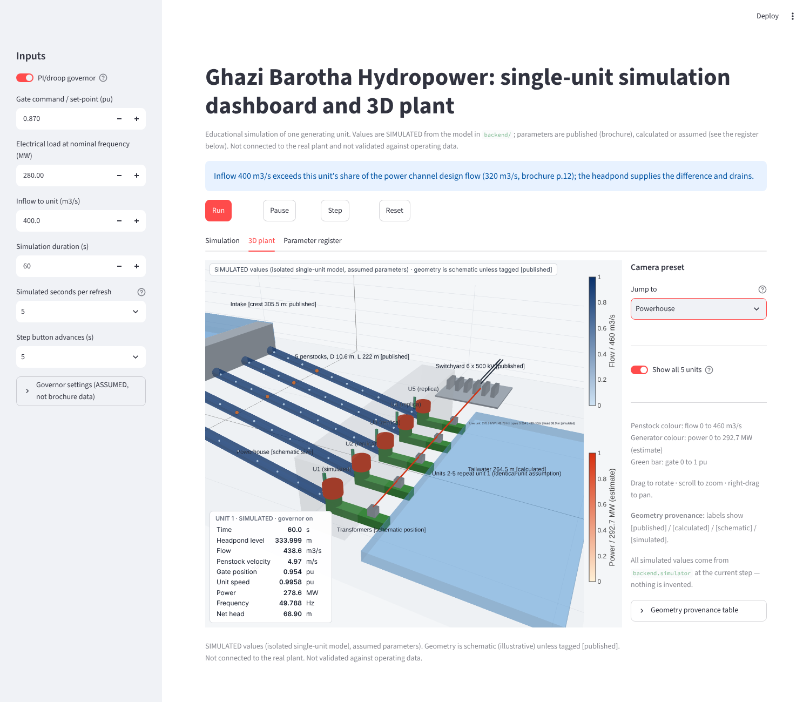
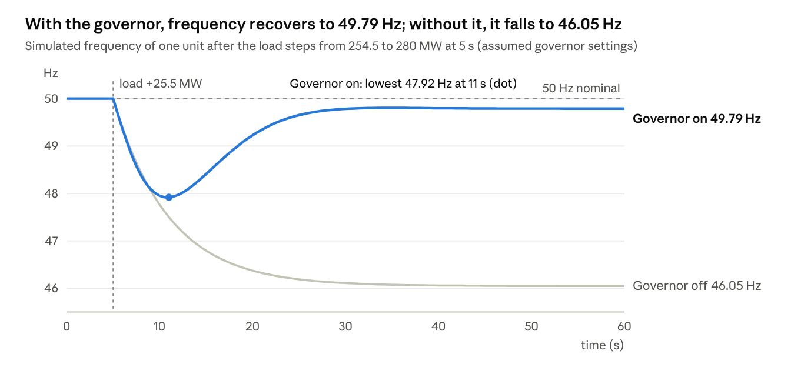

# Ghazi Barotha Digital Twin: Technical Report

23 October 2026 · Moiza

## Abstract

This project built a simulation-based digital twin prototype of one generating unit of the Ghazi Barotha Hydropower Project (1450 MW, Pakistan). It combines a nonlinear dynamic model, a PI/droop governor, a state-space linearisation, an interactive dashboard and a 3D plant view driven by the model.

Plant data come from the project brochure supplied by the teacher: 64 values, each recorded with its PDF page. Values the brochure does not give, such as generator inertia and governor settings, are assumed and labelled as such.

At the brochure operating point (69 m head, 400 m3/s), the model gives 254.51 MW per unit, and 291.67 MW at full gate. With the governor, a 10 % load step settles at 49.79 Hz; without it, frequency falls to 46.05 Hz. The linear state-space model tracks small disturbances within about 2 %.

The software passes 210 automated tests and 41 real-browser checks. It is a simulation prototype: it is not connected to the real plant and has not been validated against plant operating data.

## 1. Introduction and objectives

Ghazi Barotha is a 1450 MW project on the Indus that uses the 76 m river drop between the Tarbela tailrace and the Haro confluence (brochure p.4). A barrage diverts water into a 51.9 km lined power channel (p.12). The channel feeds headponds and a powerhouse with 5 Francis units (p.12), each with a design head of 69 m (p.17).

The aim was a *working* virtual plant rather than a static 3D model: the user changes inputs and sees flow, turbine behaviour and electrical power respond. The objectives were:

1. A dynamic mathematical model of a hydro generating unit, parameterised from the brochure.
2. A governor, so the unit can regulate frequency.
3. A state-space model dx/dt = Ax + Bu, y = Cx + Du, derived from the implemented model, with exportable matrices.
4. A dashboard with inputs, graphs and numerical results.
5. An interactive 3D representation of the plant, driven by the simulation.
6. Demonstration scenarios, tests, documentation and this report.

**Scope.** One generating unit is simulated in detail; the 3D view can show units 2 to 5 repeating its state. There is no grid model, no barrage or channel dynamics and no connection to plant data.

In this report, "digital twin prototype" means a model-driven virtual counterpart whose every displayed value comes from the simulation. It is not a twin synchronised with live measurements.

## 2. Source data and provenance

The brochure is the only source of plant data: 64 values were extracted into `source_data/source_data_register.csv`, each with its PDF page. Every value in the project is labelled with one of four classes:

| Class | Meaning | Example |
| --- | --- | --- |
| Published | Taken from the brochure, with page | Design head 69 m (p.17) |
| Calculated | Derived from published or assumed values | Power at operating point 254.51 MW |
| Assumed | Not in the brochure; a typical value, labelled | Inertia constant H = 3 s |
| Simulated | Output of the model during a run | Frequency after a load step |

The brochure values that enter the model or the 3D geometry:

| Parameter | Value | Page |
| --- | --- | --- |
| Number of units / penstocks | 5 / 5 | 12 |
| Design head | 69 m | 17 |
| Flow per unit, optimum gate / full gate | 400 / 460 m3/s | 17 |
| Combined generating efficiency | 94 % | 17 |
| Penstock diameter / length | 10.6 m / 222 m | 12 |
| Headpond normal level / live volume | 334 m / 25.5 Mm3 | 12 |
| Siphon spillway crest | 334.5 m | 12 |
| Intake crest / openings | 305.5 m / 10 | 12 |
| Power channel design flow | 1600 m3/s | 12 |
| Power channel length, bed width, depth, side slope, slope | 51 906 m, 58.4 m, 9 m, 1V:2H, 1:9600 | 12 |
| Barrage normal pond / standard bays / crest | 340 m / 20 / 332.2 m | 12 |
| Transformer (single-phase unit) / banks | 107.5 MVA / 5 | 17 |
| Switchyard / transmission | 6 bays, 500 kV, breaker-and-half / 500 kV double circuit | 12, 17 |
| Turbine type | Francis | 12 |

**Missing data** (listed in `source_data/missing_parameters.md`): generator MVA, voltage, poles and inertia; rated speed and efficiency curve; governor and servo settings; headpond level-volume curve; tailwater rating curve; penstock losses and wave speed; transformer and grid data. None of these was invented; where the model needs one, it uses a labelled assumption (Section 10).

**Open issues in the brochure:**

- Per-unit rating is given as 290 MW (p.17) and as 295 MW turbine output (p.12). Both are kept and flagged; the model uses neither.
- The rated voltage on p.12 is garbled ("515v 3:18 kV"). It is recorded as unconfirmed and not used.
- Pages 4 and 5 contain duplicate content.

## 3. System architecture and software

The software is pure Python with free libraries, so it runs on a Windows laptop with one install command and needs no internet once installed. NumPy and SciPy (Radau solver) do the computation, Streamlit serves the dashboard as a local web page, and Plotly draws the graphs and the 3D view. Heavier options were rejected: MATLAB/Simulink is not free, PyVista needs a large native download, and Three.js would require a separate JavaScript build.



The simulator is the single source of truth: the dashboard, the scenarios and the 3D view only read its state, and the state-space module also calls the model directly to linearise it. The `backend/` modules have no user-interface code, so they are tested on their own.

## 4. Mathematical model

One unit is modelled with five states: a rigid water column feeding a Francis turbine, a first-order gate servo and a swing equation (code: `backend/model.py`).

| Type | Symbol | Meaning | Unit |
| --- | --- | --- | --- |
| State | h\_p | Headpond level (this unit's share of the pond) | m |
| State | Q | Penstock and turbine flow | m3/s |
| State | y | Gate position | pu (0 to 1) |
| State | w | Rotor speed | pu |
| State | delta | Rotor angle relative to the synchronous reference | rad |
| Input | y\_cmd, P\_load, Q\_in | Gate command, electrical load, inflow | pu, MW, m3/s |
| Output | Q, h\_t, P\_gen, f | Flow, net head, generated power, frequency | m3/s, m, MW, Hz |

Turbine head, friction loss and power:

$$
h_t = \frac{Q\,|Q|}{(C_g\,y)^2}, \qquad h_f = k_f\,Q\,|Q|, \qquad P_{gen} = \frac{\eta\,\rho\,g\,Q\,h_t}{10^6}\ \text{[MW]}
$$

State equations:

$$
\dot h_p = \frac{Q_{in} - Q}{A_{pond}}
$$

$$
\dot Q = \frac{g\,A_{pen}}{L_{pen}}\,\left(h_p - z_{tw} - h_f - h_t\right)
$$

$$
\dot y = \frac{y_{cmd} - y}{T_y}
$$

$$
\dot\omega = \frac{1}{2H}\left[\frac{P_{gen} - P_{load}}{S_{base}} - D\,(\omega - 1)\right]
$$

$$
\dot\delta = 2\pi f_{nom}\,(\omega - 1), \qquad f = f_{nom}\,\omega
$$

**Calibration from the brochure.** The penstock area and length come from D = 10.6 m and L = 222 m (p.12). The turbine coefficient C\_g is fixed so that full gate at 69 m passes 460 m3/s (p.17). The optimum gate is therefore 400/460 = 0.8696 pu. Efficiency η = 0.94 (p.17).

**Operating point (calculated).** At pond level 334 m and gate 0.8696 pu the unit is in equilibrium at Q = 400 m3/s, h\_t = 69 m, **P\_gen = 254.51 MW** and 50 Hz. The water starting time is T\_w = L Q0 / (g A H0) = 1.487 s.

At full gate, the model's equilibrium is **291.67 MW** (Q = 459.47 m3/s, h\_t = 68.84 m). The often-quoted 292.69 MW = 0.94 ρ g × 460 × 69 is a calibration identity, not an independent result. Both lie within about 1 % of the brochure's conflicting 290 and 295 MW.

**Open-loop behaviour.** The eigenvalues are -2.0 (gate servo), -1.355 (penstock flow), -0.1667 (speed), -1.7e-6 (pond level) and 0 (rotor angle). Opening the gate is non-minimum phase: a +2 % gate step first lowers power by 3.7 MW at 0.3 s, then raises it by 5.7 MW. Without a governor, a 20 MW load drop drives frequency to about 53 Hz.

## 5. Governor

A PI governor with permanent droop sets the gate command; its gains give a well-damped response (damping ratio 0.85), and every setting is assumed because the brochure has no governor data (code: `backend/governor.py`). The plant equations are unchanged; the governor adds one state, the integrator ξ.

$$
e = (\omega_{ref} - \omega) - R\,(y - y_{set})
$$

$$
u = y_{set} + K_p\,e + \xi, \qquad y_{cmd} = \mathrm{clip}(u,\ 0,\ 1)
$$

$$
\dot\xi = K_i\,e + K_b\,(y_{cmd} - u)
$$

$$
\dot y = \mathrm{clip}\!\left(\frac{y_{cmd} - y}{T_y},\ -r_{close},\ r_{open}\right)
$$

In steady state e = 0, so speed settles at ω = 1 - R (y - y\_set): y\_set acts as the load reference, and R as the droop.

| Setting | Value | Unit | Basis |
| --- | --- | --- | --- |
| Permanent droop R | 0.05 | pu/pu | Assumed: common 5 % droop |
| Proportional gain K\_p | 1.0 | pu/pu | Assumed: tuned for damping on this model |
| Integral gain K\_i | 0.2 | pu/pu/s | Assumed: as K\_p |
| Gate opening / closing rate limit | 0.10 / 0.20 | pu/s | Assumed: about 10 s / 5 s full stroke |
| Anti-windup gain K\_b | 2.0 | 1/s | Assumed |
| Command limits | 0 to 1 | pu | Gate closed to fully open |

**Anti-windup.** A first version froze the integrator when the command saturated. It chattered on the limit and made the solver fail at t = 10.75 s whenever the load exceeded full-gate capacity. Back-calculation (the K\_b term) fixed it, and a regression test now covers it.

**Closed-loop poles** (1/s): -2.663, -0.550, -0.204 ± 0.127j, 0 (rotor angle) and +3.2e-6 (pond level). The pond pole is slightly positive: with the governor holding power, a falling pond lowers the head, so the turbine draws more flow, and nothing regulates the level. Its time constant is about 3.6 days, negligible over the 1 h run limit.

**Verified response.** For a +20 MW load step, frequency dips to 48.37 Hz and settles at 49.834 Hz, matching the droop prediction to 0.002 Hz.

## 6. State-space model

The matrices are a linearisation of the nonlinear model about one equilibrium, in deviation variables; they describe small departures from that operating point, not absolute values (code: `backend/model.py`, `backend/state_space.py`).

$$
\Delta\dot x = A\,\Delta x + B\,\Delta u, \qquad \Delta y = C\,\Delta x + D\,\Delta u, \qquad \Delta x = x - x_0,\ \Delta u = u - u_0,\ \Delta y = y - y_0
$$

**Method.** Each matrix is a Jacobian computed by central differences (step 1e-5 of each variable). An independent hand-derived (analytic) Jacobian agrees to better than 1e-6. The exported files are `exports/A.csv`, `B.csv`, `C.csv`, `D.csv` and `state_space_model.json`, which records states, inputs, outputs with units, the operating point, eigenvalues and parameter sources.

At the nominal point (pond 334 m, gate 0.8696 pu, 400 m3/s, 254.51 MW), with state order \[h\_p, Q, y, w, delta\] and input order \[y\_cmd, P\_load, Q\_in\]:

$$
A = \begin{bmatrix} 0 & -5.882\times10^{-7} & 0 & 0 & 0 \\ 3.900 & -1.355 & 618.9 & 0 & 0 \\ 0 & 0 & -2 & 0 & 0 \\ 0 & 9.865\times10^{-4} & -0.3025 & -0.1667 & 0 \\ 0 & 0 & 0 & 314.2 & 0 \end{bmatrix}, \quad B = \begin{bmatrix} 0 & 0 & 5.882\times10^{-7} \\ 0 & 0 & 0 \\ 2 & 0 & 0 \\ 0 & -5.168\times10^{-4} & 0 \\ 0 & 0 & 0 \end{bmatrix}
$$

$$
C = \begin{bmatrix} 0 & 1 & 0 & 0 & 0 \\ 0 & 0.345 & -158.7 & 0 & 0 \\ 0 & 1.909 & -585.4 & 0 & 0 \\ 0 & 0 & 0 & 50 & 0 \end{bmatrix}, \qquad D = 0_{4\times3}
$$

D is zero because every output depends on states only; the gate is a servo state, not a direct input. The negative C entry for power against gate position (-585.4 MW/pu) is the non-minimum-phase effect: at constant flow, a wider gate lowers the head.

**Operating point and model choice (Phase 4).** The dashboard can linearise at the nominal point or at the equilibrium with the current gate opening and pond level. A transient state is not an equilibrium and cannot be a linearisation point; the app says so. It offers the plant alone (5 states, identical to `exports/` at the nominal point) or plant plus governor (6 states, inputs \[y\_set, P\_load, Q\_in\]). Gate openings at a limit (0.02 or 1.0 pu) are rejected, because the model is not differentiable there.

**Linear versus nonlinear.** The linear model was driven with each scenario's input history and compared with the nonlinear run (largest error / largest change):

| Scenario (closed loop, nominal point) | Power | Frequency | Flow |
| --- | --- | --- | --- |
| Load step 254.5 to 280 MW | 0.45 / 25.5 MW (1.8 %) | 0.035 / 2.08 Hz (1.7 %) | 0.45 / 40.6 m3/s (1.1 %) |
| Load rejection to 0 MW | 40.3 / 243 MW (17 %) | 2.7 / 18.5 Hz (15 %) | 32 / 382 m3/s (8 %) |
| Overload 320 MW (gate saturates) | 27.8 / 37.2 MW (75 %) | 3.9 / 5.3 Hz (74 %) | 44 / 60 m3/s (74 %) |

The linear model is good for small disturbances and fails where the plant is strongly nonlinear: large flow changes, and gate saturation, which a linear model cannot represent. With the governor off and the gate fixed, the error is zero, because flow and power stay constant and only the linear swing equation acts. The matrices describe the model, not the real plant.

## 7. Dashboard and 3D plant

The dashboard is a local web app (`python -m streamlit run app.py`) with four tabs; every number and every moving part on it is read from the simulator at the current time step.

| Tab | What it shows |
| --- | --- |
| Simulation | Run, Pause, Step and Reset; 7 indicators (time, flow, net head, power, frequency, gate, pond level); 6 live graphs; result checks; CSV and results-package downloads |
| 3D plant | Interactive 3D view of the plant driven by the model, with camera presets and a live readout |
| State-space model | Matrices at a chosen operating point, eigenvalues, ZIP download, linear-versus-nonlinear chart |
| Parameter register | Every model parameter with its class (published, calculated, assumed) and source |



*Figure 1. Simulation tab at the end of the governor on/off scenario (screenshot from the running app).*

The sidebar holds the demonstration scenarios and the manual inputs: governor on or off, gate set-point, load, inflow, duration and the assumed governor settings. Inputs are validated and out-of-range values are rejected with a message, never silently clipped. While running, the model advances 5 simulated seconds per 0.6 s refresh, about 8 times real time.

**3D plant.** The view is built with Plotly 3D inside a small offline component, so it needs no internet and keeps the user's camera during live updates. It shows the barrage and pool, the power channel, the headpond and intake, 5 penstocks, the powerhouse, 5 turbines and generators, transformers, the 500 kV switchyard and the tailrace. Visual elements are bound to model variables:

| Visual | Driven by |
| --- | --- |
| Headpond water surface | Simulated pond level h\_p |
| Penstock colour | Flow Q, scaled 0 to 460 m3/s |
| Water markers and orange tracer | Distance travelled by the water, the integral of Q/A |
| Green bar, turbine colour | Gate position y |
| Generator and power-line colour | Power P\_gen |
| Readout panel | Time, level, flow, velocity, gate, speed, power, frequency, head |



*Figure 2. 3D plant tab, Powerhouse preset (screenshot from the running app). Layout is schematic; levels and penstock size are from the brochure.*

**Geometry provenance.** Elevations, penstock size, channel cross-section and the counts of units, bays and banks are published. The plan layout, unit spacing, powerhouse and machine sizes and the straight penstock route are schematic, because the brochure has no site plan. Labels in the scene say which is which, and a 43-row provenance table lists every dimension with its source.

## 8. Demonstration scenarios and results



Five one-click scenarios run the real model and governor from the operating point; the governor holds frequency within 0.21 Hz of nominal after a 10 % load step, while full load rejection and overload push the model past its limits. Each scenario is only a schedule of inputs; the tests confirm that its results equal stepping the model by hand.

| Scenario | Disturbance at 5 s | Frequency, extreme / final | Power, final | Gate, final | What it shows |
| --- | --- | --- | --- | --- | --- |
| Normal operation (60 s) | None | 50.00 / 50.00 Hz | 254.5 MW | 0.870 pu | The model is in equilibrium |
| Load increase (120 s) | Load 254.5 to 280 MW | 47.92 / 49.79 Hz | 278.6 MW | 0.954 pu | Power first dips to 252.3 MW (water inertia), then the governor restores balance with droop |
| Load rejection (120 s) | Load 254.5 to 0 MW | 68.45 / 52.06 Hz | 13.3 MW | 0.045 pu | Head peaks at 86.2 m; flagged as outside the model's valid speed range |
| Overload (120 s) | Load 254.5 to 320 MW | 44.71 / 45.60 Hz | 291.6 MW | 1.000 pu | Gate saturates; the unit cannot meet the load; limit warning shown |
| Governor off (reference) | Load 254.5 to 280 MW | 46.05 / 46.05 Hz | 254.5 MW | 0.870 pu | Gate stays fixed; only load damping (assumed D) limits the fall |

Final values are at the end of each run. Scenario settings (event time, new load, duration) are demonstration choices, adjustable in the app and validated; they are included with the assumptions in each exported results package.

The load-rejection overspeed should not be read as a prediction for the real plant: the model has no overspeed protection and ignores the effect of speed on turbine flow (Section 10).

## 9. Testing and verification

All 210 automated tests pass (`python -m pytest`, about 100 s), and 41 of 41 real-browser checks pass; this verifies the software against its own equations and hand calculations, but it does not validate the model against the real plant.

| Test file | Tests | What it checks |
| --- | --- | --- |
| test\_model.py | 18 | Register values, steady state, hand-calculated power and Jacobian entries, linear vs nonlinear step, export |
| test\_governor.py | 22 | Settings validation, equilibrium, poles and damping, droop steady state, limits, anti-windup, overload |
| test\_simulator.py | 27 | Input validation, stepping, mass balance, reproducibility, CSV |
| test\_app.py | 10 | Headless dashboard: buttons, Run against an independent backend calculation, Pause, Reset, overload |
| test\_plant3d.py | 57 | Mesh geometry, published dimensions, provenance, 3D figure built from model state |
| test\_app\_3d.py | 8 | Values given to the 3D view equal the simulator state at start, during and after a run |
| test\_scenarios.py | 37 | Each scenario's physics, scenario equals manual stepping, invalid inputs rejected, failures caught, export |
| test\_state\_space.py | 16 | Export identical to Phase 1 files, closed-loop poles, other operating points, linear vs nonlinear |
| test\_app\_phase4.py | 14 | Each scenario through the dashboard equals an independent backend run; state-space tab |
| test\_check\_setup.py | 1 | The installation check script passes |

**Real browser** (Chromium with Playwright, `tests/e2e_browser*.py`): dashboard 13/13, 3D view 12/12, Phase 4 features 16/16. These checks found a defect that headless tests missed: charts were blank while running. The 3D test also confirmed that the app makes no internet requests.

**Defects found and fixed during development** (selection):

- Anti-windup chatter made the solver fail at loads above full-gate capacity (Section 5).
- A mass-balance test was wrong, not the model: it used the pre-step inflow.
- Live charts were blank during a run; the refresh interval was set from measurements (blank 29 % of the time at 0.25 s, 3 % at 0.6 s).
- The 3D view would have frozen during a run; it got its own refresh timer.
- A scenario description claimed the gate closes at its rate limit; the model shows a peak of 0.136 pu/s, below the 0.20 limit, and the text was corrected.

**Verification versus validation.** Verification asks whether the code solves the stated equations correctly; the tests answer yes, within the checks listed. Validation asks whether the model reproduces the real plant; it cannot be done without plant operating records, and has not been done. All tests ran on Linux. The Phase 3 dashboard (with the 3D view) was confirmed to launch on the author's Windows laptop; the Phase 4 version is to be checked there with `python check_setup.py`.

## 10. Assumptions and limitations

The dynamics depend on eight assumed parameters that the brochure does not give; results are therefore indicative of a plant of this size, not of the actual Ghazi Barotha units.

| Assumed parameter | Value | Why this value | What it affects |
| --- | --- | --- | --- |
| Inertia constant H | 3 s | Typical hydro generator, 2 to 4 s | Speed of frequency change |
| Load damping D | 1 pu | Typical 1 to 2 pu | Frequency deviation without a governor |
| Gate servo time constant T\_y | 0.5 s | Typical for large Francis units | Gate response |
| Penstock friction loss at 400 m3/s | 0.5 m | Short, wide penstock, so small | Tailwater level, damping |
| Usable headpond drawdown | 3 m | Level-volume curve missing | Slow pond-level dynamics only |
| Generator MVA base S\_base | 322.5 MVA | 3 × 107.5 MVA transformer rating (p.17) | Per-unit scaling, load input limit |
| Nominal frequency | 50 Hz | Pakistani grid standard; not stated in brochure | Frequency output |
| Gate floor y\_min | 0.02 pu | Numerical, avoids division by zero | Gate cannot fully stop the flow |

The governor settings in Section 5 are also assumed, as are the scenario settings (start point, event time, new load).

**Model limitations:**

- Rigid water column: no water hammer waves; the penstock head rise is a lumped estimate.
- Constant efficiency (94 %) and no effect of speed on turbine flow; the model is credible for speed within about 0.9 to 1.1 pu. A full load rejection reaches 68.5 Hz in the model, and the app flags it.
- No overspeed protection, unit trip, spillway, barrage or channel dynamics.
- One isolated unit with load damping; no grid, other units or electrical network model.
- Generated power (net of losses) is used as mechanical input in the swing equation, a small simplification.
- The inflow default of 400 m3/s exceeds one unit's share of the channel design flow (1600/5 = 320 m3/s, p.12); the app notes this.
- The 3D layout is schematic where the brochure gives no dimensions.
- No validation against measured plant data.

## 11. Demonstration guide

A 10-minute demonstration needs one command and five scenario clicks; prepare it the day before with the installation check.

**Before the demonstration** (Windows Command Prompt, project folder unzipped into Documents):

```
cd %USERPROFILE%\Documents\Ghazi_Barotha_Digital_Twin
pip install -r requirements.txt
python check_setup.py
python -m streamlit run app.py
```

`check_setup.py` should print 7 PASS lines. The last command opens the dashboard at http://localhost:8501; if Streamlit asks for an email, press Enter. Stop it with Ctrl+C. No internet is needed once the packages are installed.

**Demonstration script:**

1. **Introduce the data (1 min).** Open the Parameter register tab. Say: every value is labelled published (with brochure page), calculated or assumed.
2. **Normal operation (1 min).** Sidebar: choose *Normal operation*, press Start scenario. Say: the model sits in equilibrium at 400 m3/s, 69 m, 254.5 MW, 50 Hz, all calculated from brochure data.
3. **Load increase (2 min).** Choose *Electrical load increase*, Start. Point to the brief power dip after 5 s (water inertia: opening the gate first lowers the head), then the governor bringing frequency back to 49.79 Hz. Explain droop: a 5 % droop leaves a small steady offset by design.
4. **Governor on versus off (1 min).** Choose *Governor enabled vs disabled*, Start. The grey dotted curve is the same load step without a governor: frequency falls to 46.05 Hz.
5. **3D plant (2 min).** Open the 3D plant tab, preset Powerhouse, and replay a scenario with Reset and Run. Show the gate bar, the turbine colour and the orange tracer moving. Rotate the view while it runs. Say: layout is schematic, levels and penstock size are from the brochure, every moving value is simulated.
6. **Overload (1 min).** Choose *Overload*, Start. The gate saturates at 1.0, power stops at 291.6 MW and frequency falls to 45.6 Hz. Open Result checks to show the limit warning.
7. **State-space (2 min).** Run *Electrical load increase* again, open the State-space model tab and choose *Plant + governor (closed loop)*. The linear and nonlinear curves overlap. Then run *Overload* and return: the linear model misses the saturation. Download the matrices to show the export.

**Questions to expect:**

- *Is this connected to the real plant?* No. It is a simulation built from brochure data, with labelled assumptions.
- *Why is frequency not exactly 50 Hz after the load step?* Permanent droop shares load between units; a secondary (AGC) control would restore 50 Hz, which is not modelled.
- *Why does load rejection reach 68 Hz?* The model has no overspeed protection or speed-dependent turbine model; the app flags this run as outside the valid range.

## 12. Conclusions and future work

The project delivers a working, tested simulation prototype of a Ghazi Barotha generating unit: brochure data drive a nonlinear model, a governor, a state-space model, a dashboard and a 3D view, and every value is labelled by its origin.

The main engineering findings, all from the model:

- The brochure data give a consistent operating point: 254.51 MW at 400 m3/s and 69 m, and 291.67 MW at full gate, within 1 % of the brochure's 290 and 295 MW ratings.
- The water column makes gate opening non-minimum phase (T\_w = 1.49 s): power briefly falls before it rises.
- A unit without a governor cannot hold frequency; with an assumed 5 % droop PI governor, a 10 % load step settles at 49.79 Hz.
- Linearisation is accurate to about 2 % for a 10 % load step, and fails under gate saturation and full load rejection.

The most valuable next steps, in order:

1. **Obtain plant data** (governor settings, inertia, efficiency curve, operating records) and validate the model against measured responses.
2. **Add an elastic water column** for water hammer, and a speed-dependent turbine model, to cover load rejection.
3. **Model all five units** sharing the headpond, with the power channel inflow.
4. **Add overspeed protection and secondary frequency control** to represent full plant operation.
5. **Connect to logged data** (for example a CSV of SCADA records) to move from a simulation prototype toward a data-driven twin.

## 13. References and appendix

**Primary source.** Ghazi Barotha Hydropower Project brochure (20 pages), supplied by the course teacher; stored as `source_data/original_brochure.pdf`. Pages used: 4 (capacity, energy, river drop), 7 (peaking duration), 12 (units, penstocks, barrage, power channel, headponds, intake, switchyard, turbine type), 13 and 15 (project dates and costs), 17 (head, flows, efficiency, transformers, transmission, unit rating).

No other plant-specific source was used. Typical values for assumed parameters (Section 10) are standard textbook orders of magnitude, labelled as assumptions.

**Project files** (in `Ghazi_Barotha_Digital_Twin_Phase4.zip`, with Git history):

| Path | Content |
| --- | --- |
| `app.py`, `ui/` | Dashboard and its panels |
| `backend/model.py` | Plant equations, steady state, linearisation, export |
| `backend/governor.py`, `backend/simulator.py` | Governor and simulation engine |
| `backend/scenarios.py`, `backend/state_space.py` | Scenarios, result checks, export; state-space at a chosen point |
| `backend/plant3d.py`, `frontend/plant3d/` | 3D scene and offline viewer |
| `source_data/` | Brochure, 64-value register, missing-parameter list |
| `exports/` | A, B, C, D matrices and metadata (nominal point) |
| `documentation/` | Model, assumptions, state-space method, testing, architecture, user manual |
| `tests/` | 210 automated tests and 3 browser test scripts |
| `PROGRESS.md`, `PROJECT_CONTEXT.md`, `CHANGELOG.md` | Project history and how to resume |

**Reproduce the results:**

```
python -m backend.model        (regenerates exports/ and prints the operating point)
python -m pytest               (210 tests)
python -m streamlit run app.py (dashboard; scenario results as in Section 8)
```

Software: Python 3.13, NumPy 2.5.3, SciPy 1.18.1, Plotly 7.1.0, Streamlit 1.65.0, pytest 9. All free and open source.
